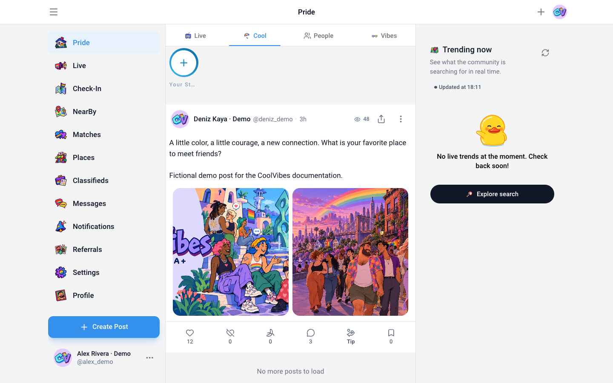
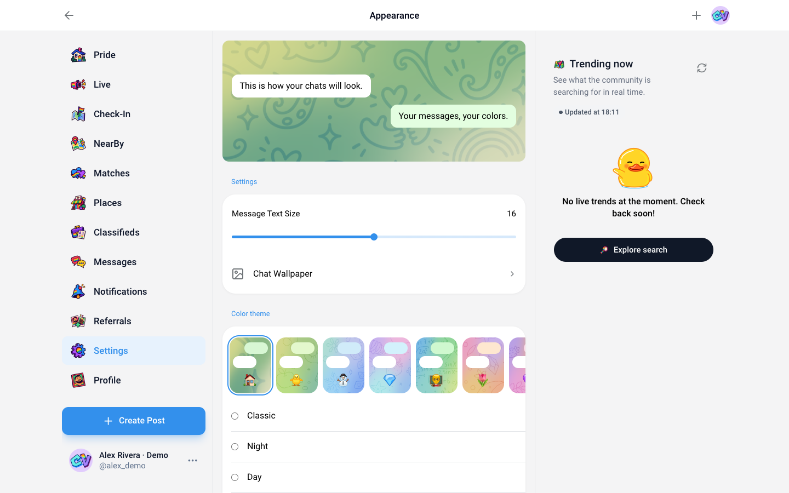
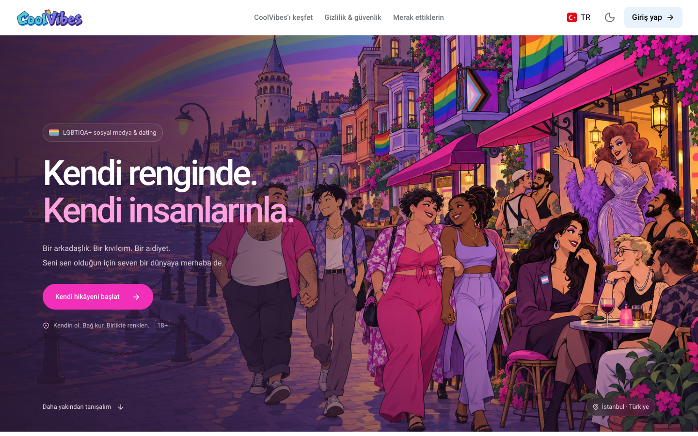
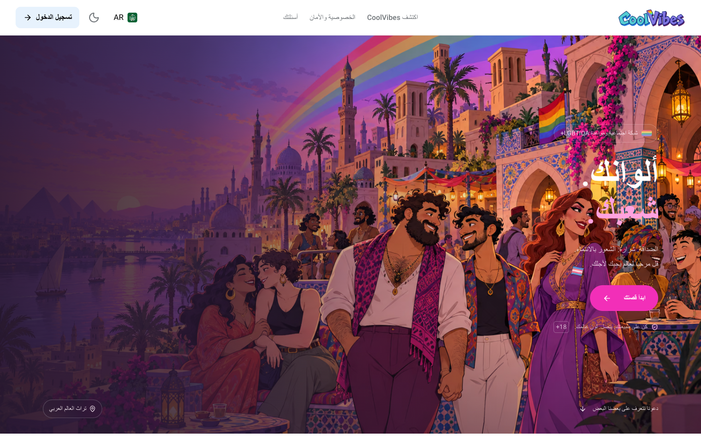

  

# CoolVibes — Gay Social Network & LGBTQIA+ Dating

**Your colors. Your people.** CoolVibes is a **gay social network and dating community** where LGBTQIA+ adults and respectful allies can meet people, make friends, share their lives and find connections. Whether you are looking for a conversation, a local community, a date or people who share your interests, CoolVibes brings those experiences together.

With **CoolVibes for Visual Studio Code**, your community is a click away. Browse the feed, check your messages and explore profiles in the sidebar, or open a larger panel for more room. Use your existing CoolVibes account and connect with the same community you know from the website.

**For adults aged 18 and over.** Gay, bi, lesbian, trans, queer and other LGBTQIA+ people, along with respectful allies, are welcome.

[Join CoolVibes](https://coolvibes.lgbt) · [Install from Marketplace](https://marketplace.visualstudio.com/items?itemName=CoolVibes.coolvibes-vscode-extension) · [Help and community rules](https://coolvibes.lgbt/legal)

## A community beyond the swipe

CoolVibes combines a social feed, personal profiles, friendship, dating, nearby discovery and messaging. Share something that matters to you, get to know someone through their posts and interests, or start a private conversation. You can participate in the wider community and build individual connections in the same place.

## Share your world

The **Pride community feed** is a place for updates, photos, conversations and everyday moments. Write text and media posts, reply to others, react to what they share and bookmark posts you want to revisit. Create polls to hear from the community and use event posts to share plans and collect responses.

Explore community content and discover people through what they say and share, as well as their profile.

## A profile that feels like you

Express yourself with your biography, photos, interests, identity and preferences. Let people learn more about your personality and what you are looking for, then explore their profiles, posts and shared interests in return.

Manage **friend requests**, view followers and profile engagement, and keep your public and private photos in their own profile tabs. Private-photo access requests let you decide who can see restricted albums, with options to approve requests and revoke access later. Visibility settings help you choose which personal details you share.

  

## Meet people, make friends and find dates

Use search and discovery to explore the community, find people with interests that catch your attention and start new connections. **Likes and matches** add a dating experience alongside the social network, while **NearBy** helps you explore people around you when you choose to share your location.

You decide whether a connection becomes a conversation, a friendship or something more. Discovery options and advanced features can vary with account membership and availability.

## Keep the conversation going

Bring your conversations into VS Code with **private and group messaging**. Reply to a specific message, edit a message, forward something useful or pin information you want to keep easy to find. Share attachments, express yourself with emoji, stickers and GIFs, and continue the conversation with the people you meet.

Create and manage groups, choose members, update group details and share invitation links. Public and private group options help you bring people together around friendships and shared interests.

## Discover places and community activity

Explore **Places** to find locations and view map and place details. Check-in flows connect community activity with the places people visit. Use the **Classifieds** area to browse community listings and requests by category and open the ones that interest you.

Nearby discovery, maps and check-ins depend on available local information and your location permissions. Community listings are contributed content, not a guarantee or endorsement of a provider.

## Explore live broadcasts and member features

The **Live** area brings broadcast discovery and participation into the community experience. Explore available streams and participation options; broadcasting and joining can depend on membership, camera/microphone access and service availability. Open the website when a media permission or browser feature is needed.

CoolVibes also includes **Premium**, **Wallet** and **Referrals** areas for the membership options, balances, transaction history and referral rewards available to your account. Payment methods, rewards and financial actions depend on your region, account and supported providers; not every option is active everywhere.

## Make CoolVibes your own

Choose **light, dark or system appearance**, pick an accent color and personalize your conversations with message sizing, chat gradients, patterns and wallpaper. Preview your choices and create a look that feels comfortable for you, whether you use a narrow sidebar or a wide panel.

## Your community, in your language

CoolVibes includes **23 language and regional variants**: English, Turkish, German, Spanish, French, Arabic, Bengali, Persian, Hebrew, Hindi, Indonesian, Japanese, Khmer, Nepali, Polish, Portuguese, Russian, Thai, Chinese variants for mainland China, Hong Kong and Taiwan, and Korean variants for North and South Korea.

Arabic, Persian and Hebrew support right-to-left layouts. Localized welcome pages feature regional community artwork, so the experience feels closer to home from the start.

## Choose what you share

Use profile visibility, private-photo permissions, blocking and reporting controls to manage your experience. Treat other members with respect and follow the [community rules](https://coolvibes.lgbt/legal). Private conversations and restricted photos follow account access controls; private messaging is not a claim of end-to-end encryption.

## Start using CoolVibes in VS Code

1. Install **CoolVibes** from the Visual Studio Marketplace.
2. Select the **CoolVibes CV icon** in the Activity Bar.
3. Sign in with your CoolVibes account and explore the community.
4. For a larger view, open the Command Palette and select **CoolVibes: Open Panel**.

New here? Create your account at [coolvibes.lgbt](https://coolvibes.lgbt), then return to the extension and sign in. Your sign-in stays synchronized between the extension's sidebar and panel. External links open in your browser.

You need **VS Code 1.85 or later**, an internet connection and a CoolVibes account for member features. Public artwork loads from the CoolVibes website. Location, live media and payments remain subject to device permissions and service availability; some actions may open or require the website.

## About these screenshots

These existing screenshots show the **actual CoolVibes web interface** used by the extension. Authenticated views contain fictional demonstration profiles and messages, not real members' private information. They illustrate the product at different screen sizes; they are not captures of VS Code's surrounding editor chrome.

## Stay connected

- [Visit CoolVibes](https://coolvibes.lgbt)
- [Read help, privacy information and community rules](https://coolvibes.lgbt/legal)
- [Report an extension issue](https://github.com/CoolVibesLGBT/vscode_extension/issues)
- [See release notes](CHANGELOG.md)
- [Developer and publishing guide](DEVELOPMENT.md)
